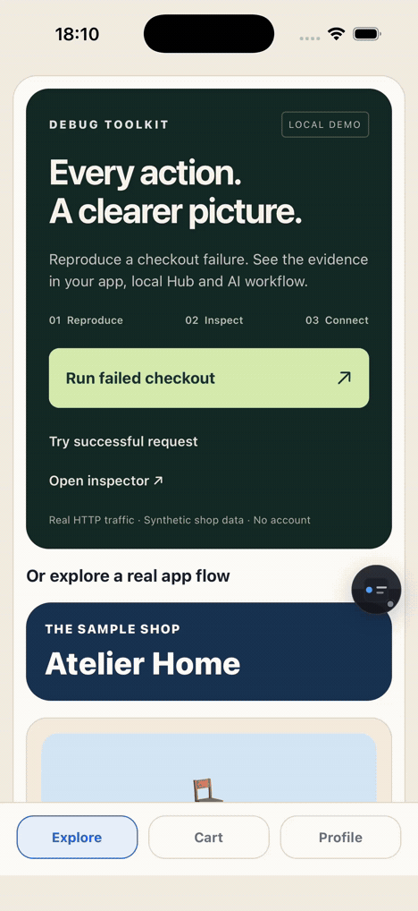
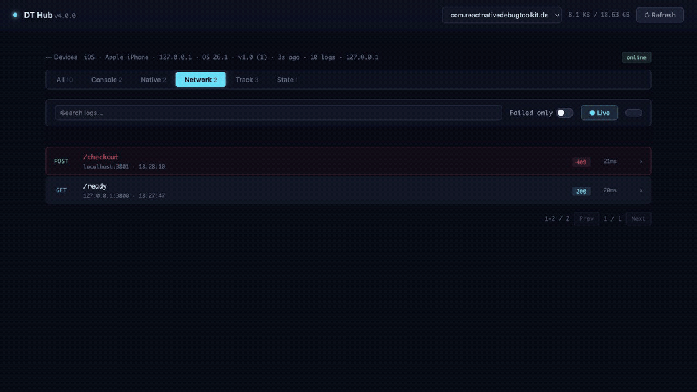

# React Native Debug Toolkit

**From an action in your app to the evidence behind it.**

[中文](README-zh-CN.md) · [Try the Demo](https://github.com/superzcj/react-native-debug-toolkit/blob/main/Demo/README.md) · [Integration guide](docs/integration.md) · [Configuration reference](docs/configuration.md)

A React Native debugging toolkit for development and internal builds: inspect HTTP requests and console logs in an in-app inspector, follow device activity in a local Web Console, and give AI coding assistants runtime evidence to investigate alongside your code.

Reproduce on the phone. Inspect on the desktop. Ask your AI what happened.

<p align="center"></p>

<p align="center"><sub>Requests, state, analytics events, environments, text sharing and log sync. About 18 seconds.</sub></p>

## Three ways to investigate

| Where you work             | What it gives you                                                                                                                            |
| -------------------------- | -------------------------------------------------------------------------------------------------------------------------------------------- |
| **Inside the app**         | A floating inspector keeps requests, console output and state changes close to the action. Check a failure while reproducing it on a device. |
| **In your browser**        | The local Hub collects device sessions. Search logs, expand request details and watch new events arrive while you operate the app.           |
| **With your AI assistant** | Read-only diagnostic commands provide runtime evidence for investigation; app integration follows the guides.                                |

No account or cloud log service required. The Hub runs on your computer.



**Bring device information to your computer:** app activity flows into the Hub. For a diagnostic note, enter text in Clip and tap Copy; view and copy it in the browser Console.

## Built for everyday debugging

| Capability                   | What you can inspect or control                                                                                                            |
| ---------------------------- | ------------------------------------------------------------------------------------------------------------------------------------------ |
| **Network**                  | Request status, timing, headers and request/response bodies from XMLHttpRequest and global fetch; text and JSON responses are inspectable. |
| **Console & Native**         | JS output and supported native logs in the same toolkit                                                                                    |
| **State**                    | Zustand actions and before/after values; explicit logging for other state systems                                                          |
| **Navigation**               | Route transitions, previous/next routes and timing                                                                                         |
| **Track / Analytics**        | Inspect instrumented event names, properties and timestamps to verify analytics tracking                                                   |
| **Custom tabs**              | Your app's own live snapshots: a cart, feature flags or user context                                                                       |
| **Environment switching**    | Switch configured development/test API hosts or URL prefixes and retain the selection                                                      |
| **Phone → Mac text sharing** | Send text through Clip/Copy to Console; view and copy it in the Mac browser Hub                                                            |
| **Quick actions**            | Long-press the floating launcher to run configured actions, such as switching environments or refreshing a page                            |
| **Log sync**                 | Send network, JS/native logs, state, navigation and analytics events to the local Hub, once or continuously                                |
| **Test accounts / Sessions** | Integrate account switching and revisit retained logs                                                                                      |

Network and console capture start automatically after initialization. State, navigation, events and business tools use small integrations. [See the integration examples and capture limits](docs/configuration.md)

## Find the evidence behind a bug

- **Inspect HTTP requests on a device:** see XHR/global fetch status, headers, timing, and text/JSON bodies in the Network panel or local Web Console.
- **Explain a state or navigation change:** connect a Zustand adapter, a navigation ref, or explicit events to inspect what changed alongside the request.
- **Check analytics events:** record event names and properties to verify what fired during a user action.
- **Give an AI assistant runtime logs:** use the local Hub and diagnostic CLI to inspect the same evidence alongside your source code. No AI API is called by the toolkit.

## Get started

### Add the in-app inspector

The documented integration path is React Native CLI. An isolated Expo 58 / RN 0.88.0 / Nitro 0.37.1 app has also passed an iOS simulator Release build and native runtime checks. Expo Go is unsupported; Expo Router, Android on this newer combination, and legacy architecture remain unverified. See the [support matrix](docs/integration.md#1-find-the-existing-root) for the scope of each check.

Install the package and native dependencies in your existing React Native CLI app:

```sh
npm install react-native-debug-toolkit react-native-mmkv@4.3.2 react-native-nitro-modules@0.35.10 @react-native-clipboard/clipboard@1.16.3
cd ios
pod install
cd ..
```

Wrap your existing root component:

```tsx
import React from "react";
import { Text } from "react-native";
import { withDebugToolkit } from "react-native-debug-toolkit";

function App() {
  return <Text>My App</Text>;
}
export default withDebugToolkit(App);
```

The wrapper registers the default pages. Network, Console and Native capture after setup; State, Navigation, Track, Environment, Accounts and Custom stay empty until you provide a source, ref, event or real business data. Connect uses the native app identity automatically, so this example does not need an `appId`. [See the full configuration and examples](docs/configuration.md).

Rebuild the native app, then tap the floating launcher. The in-app inspector also works without a Hub. To choose Simplified Chinese, pass `withDebugToolkit(App, { locale: 'zh-CN' })`; omitted locale follows the device language.

### Connect your browser and AI assistant

Hub discovery is off by default. This requires a Toolkit build that includes `withDebugToolkitMetro`; published 4.1.2 predates it. To enable discovery while `hub dev` is running, wrap the app's Metro config and restart Metro:

```js
const { getDefaultConfig } = require('@react-native/metro-config');
const { withDebugToolkitMetro } = require('react-native-debug-toolkit/metro');
module.exports = withDebugToolkitMetro(getDefaultConfig(__dirname), { projectRoot: __dirname });
```

For Expo, use `getDefaultConfig` from `expo/metro-config`; pass your existing config to the wrapper. Without the wrapper, Connect remains available for manual upload.

From your app project, start the Hub:

```sh
npx --no-install debug-toolkit hub dev
```

Open [localhost:3800](http://127.0.0.1:3800/). With the Metro wrapper, Debug builds connect while the Hub runs and stop when it exits. If Fast Refresh is disabled, reload the app after starting or stopping the Hub. Physical devices need a reachable LAN address for your computer.

To let an AI assistant investigate, optionally install the diagnosis Skill once:

```sh
npx --no-install debug-toolkit init
```

Commit the generated `.agents/skills/react-native-debug-toolkit/SKILL.md` and `AGENTS.md` changes. In an assistant that can load them and reach the Hub, reproduce the problem and ask:

> Investigate why that checkout failed, using the runtime logs to locate the relevant code.

Toolkit supplies runtime evidence; your AI assistant does the analysis. App integration itself needs no Skill—follow the [integration guide](docs/integration.md). [Connection settings, build modes and troubleshooting →](docs/setup.md)

After reproducing the issue, retrieve machine-readable diagnostics:

```sh
npx --no-install debug-toolkit diagnose --json
```

The response identifies available runtime evidence or the next step needed to collect it. Diagnostic commands read evidence; `hub dev` stores logs locally, and `init` installs the optional Skill. See the [diagnostic response example](docs/setup.md#minimal-ai-diagnosis-example).

## Try it with a real request

The [Demo](https://github.com/superzcj/react-native-debug-toolkit/blob/main/Demo/README.md) includes a local shop API. Trigger an inventory conflict, inspect the **HTTP 409 and JSON response**, follow the **state and analytics events**, switch to **Staging**, and watch **201 arrive in the Hub**. Use Clip to send a note to your computer. The data is synthetic; requests use the real React Native network stack.

Use in Debug and internal builds. Release is disabled by default; internal builds need explicit enablement and manual upload in Connect. Keep public production builds disabled. Run the Hub on a trusted network and review logs before sharing; they are not automatically redacted.

[MIT license](LICENSE)

## Application log channels

Configure a static log channel to give application diagnostics their own first-level phone and Hub tab. Keep the original message and data; an optional summary improves scanning without replacing evidence.

```tsx
withDebugToolkit(App, {
  logChannels: [
    { id: "ble", title: "Bluetooth", maxLogs: 1000, maxBytes: 2 * 1024 * 1024 },
  ],
});

await debug.ready();
debug.log("ble", {
  timestamp: Date.now(),
  message: "ATT write acknowledged",
  summary: "NFC setting · sent",
  category: "tx",
  source: { id: "sdk-instance", sequence: 1 },
  attachments: [{ label: "Plaintext", value: "00 01 ff" }],
  data: { receipt: "attWriteResponse" },
});
debug.open("channel.ble");
```

`debug.log` returns `recorded`, `duplicate`, `disabled`, `not_ready`, or `invalid`. It does not wait for disk or Hub delivery. `detail: true` hides process noise from the default list; search, “Include process,” and raw export retain it. Source sequences must increase within each source ID. Clearing preserves bounded replay watermarks, so old SDK cache entries do not reappear.

The channel keeps the newest records within both configured limits (defaults: 1000 entries / 2 MiB). Oversized records are marked truncated at 16 KiB. Phone export includes all retained process records. Hub shows a recent 1000-event window; channel export pages through retained server records, including live arrivals through the export boundary. Buffer loss produces a visible gap. Phone clear does not delete Hub history.

Channel IDs accept 1–40 ASCII letters, digits, underscores, or hyphens. Configure at most 16 channels. No Bluetooth protocol code is part of Toolkit.
